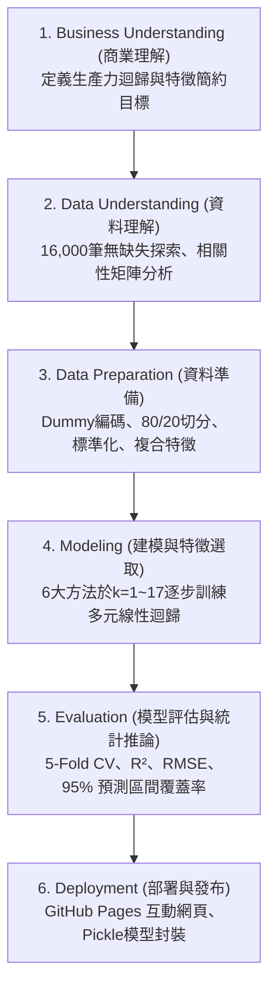

# 🎓 HW2: Multiple Linear Regression & Feature Selection Explorer
### 學生表現預測機器學習挑戰（CRISP-DM 完整流程與統計推論分析）

> 🌐 **GitHub Pages 互動式網站：** [https://yuwen0621.github.io/1014_DIC/](https://yuwen0621.github.io/1014_DIC/)  
> 📦 **Kaggle 資料集來源：** [Student Performance Prediction Machine Learning Challenge](https://www.kaggle.com/competitions/student-performance-prediction-machine-learning-challenge/data)  
> 🏫 **課程：** 資料推論與計算 (Data Inference & Computing, DIC) — 作業二：多元線性迴歸 (Multiple Linear Regression)

---

## 📌 1. 專案簡介 (Project Overview)

本專案針對 Kaggle **Student Performance Prediction Machine Learning Challenge** 比賽資料集，依照資料探勘國際標準方法論 **CRISP-DM**（Cross-Industry Standard Process for Data Mining）六大階段，實現了完整、嚴謹且可重現的 **多元線性迴歸（Multiple Linear Regression, OLS）** 與 **特徵選取（Feature Selection）** 分析系統。

### 核心目標
1. **預測目標：** 預測學生的連續型學習生產力指標 **`productivity_score`**（範圍 $0.0 - 100.0$）。
2. **比較特徵選取方法：** 系統性比較 **6 種機器學習特徵選取演算法** 在特徵維度 $k = 1 \dots 17$ 逐步遞增下的預測表現與泛化能力。

4. **個別樣本預測不確定性估計：** 推導並計算學生個別預測值的 **95% 預測區間（95% Prediction Interval, PI）**，區分個別預測區間與平均值信心區間（Confidence Interval）的統計差異。
5. **雲端互動部署：** 開發符合 GitHub Pages 原生環境的無後端（Serverless）互動式 Web 儀表板，支援即時特徵調控、動態甜點標示、Progression 圖表切換與 Live Predictor 試算。

---

## 📊 2. 資料集規格說明 (Dataset Specification)

| 屬性項目 | 規格值 | 說明 |
|---|---|---|
| **資料來源** | Kaggle 競賽 | Student Performance Prediction Machine Learning Challenge |
| **總樣本數** | **16,000 筆** | 結構完整，缺失值（Missing Values）總數為 0 |
| **資料分割** | **80% 訓練集 / 20% 測試集** | 訓練集 12,800 筆 / 測試集 3,200 筆（`random_state=42` 固定種子） |
| **交叉驗證** | **5-Fold Cross Validation** | 嚴格限定於訓練集內部切分，杜絕任何資訊洩漏（Data Leakage） |
| **預測目標 (Target)** | `productivity_score` | 連續型數值（$0.0 - 100.0$），平均值：50.15，標準差：16.10 |
| **類別型編碼** | Dummy Encoding | `gender` 虛擬變數化，以 `Female` 為基準類別（避免虛擬變數陷阱） |
| **特徵工程** | 領域交互特徵 | 建立 `study_efficiency` 與 `screen_distraction_index` 引入自然共線性 |
| **候選預測變數 ($p$)**| **17 個特徵** | 包含 15 個量化特徵 + 2 個性別指示虛擬變數 |

### 17 個候選預測變數列表
1. **`study_hours_per_day`**：每日學習時數（0.5 – 10.0 小時/天）
2. **`focus_score`**：專注度評分（30 – 100 分）
3. **`sleep_hours`**：睡眠時數（3.0 – 10.0 小時/夜）
4. **`phone_usage_hours`**：手機使用時間（0.5 – 12.0 小時/天）
5. **`stress_level`**：自評壓力指數（1 – 10 分）
6. **`attendance_percentage`**：課堂出席率（40.0% – 100.0%）
7. **`study_efficiency`**：學習效率複合指標（$\text{study\_hours} \times \frac{\text{focus\_score}}{100}$）
8. **`screen_distraction_index`**：螢幕分心指數（$\ln(1 + \text{phone} + \text{gaming} + \text{youtube})$）
9. **`gaming_hours`**：電玩時數（0.0 – 6.0 小時/天）
10. **`breaks_per_day`**：每日休息次數（1 – 14 次）
11. **`exercise_minutes`**：運動時間（0 – 120 分鐘）
12. **`assignments_completed`**：作業完成數量（0 – 19 項）
13. **`social_media_hours`**：社群軟體使用時數（0.0 – 8.0 小時/天）
14. **`youtube_hours`**：觀看 YouTube 時數（0.0 – 6.0 小時/天）
15. **`age`**：學生年齡（17 – 30 歲）
16. **`gender_Male`**：男性虛擬變數（1 = 男性, 0 = 否）
17. **`gender_Other`**：非二元/其他性別虛擬變數（1 = 其他, 0 = 否）

*(註：原始資料集包含 `id` 與 `student_id` 作為辨識碼已被移除；`final_grade` 與 `coffee_intake_mg` 亦在資料前處理階段排除以聚焦純粹生活形態預測)*

---

## 🔬 3. CRISP-DM 六大階段分析流程 (Methodology)



### 階段一：商業與研究理解 (Business Understanding)
- **分析動機：** 教育機構與自律學習者需要了解哪些生活與學習行為真正決定學習成效，避免投入無效干預。
- **建模目標：** 建構可解釋性最高、係數物理意義明確的多元線性迴歸模型（OLS），以最少關鍵預測變數（Parsimonious Model）達到最小預測均方根誤差（RMSE）。
- **嚴謹性規範：** 所有特徵重要性評估、選取與超參數調校**嚴格限定於 80% 訓練集**，測試集僅在最終評估階段使用一次。

### 階段二：資料理解 (Data Understanding)
- 檢查 Kaggle 資料集 16,000 筆樣本，各欄位資料型態正常且無任何缺漏值。
- 計算 Pearson 相關係數矩陣發現：
  - 與生產力強烈正相關：`study_hours_per_day` ($r = 0.73$)、`focus_score` ($r = 0.42$)、`sleep_hours` ($r = 0.34$)、`attendance_percentage` ($r = 0.17$)。
  - 與生產力負相關：`phone_usage_hours` ($r = -0.33$)、`stress_level` ($r = -0.20$)。
  - 噪聲干擾特徵：`age`、`gaming_hours`、`social_media_hours` 等相關係數絕對值均極低（$|r| < 0.05$）。

### 階段三：資料準備 (Data Preparation)
- **類別虛擬化：** 將三分類性別欄位 `gender` 轉化為 2 個虛擬變數，基準類別為女性（`Female`）。
- **特徵工程：** 構築交互特徵 `study_efficiency` 與對數轉換指標 `screen_distraction_index`，引導演算法在存在相關結構時的特徵選取鑑別度。
- **資料集切分：** 使用固定隨機種子 `random_state=42` 將 16,000 筆資料切分為訓練集 12,800 筆（80%）與測試集 3,200 筆（20%）。
- **標準化前處理：** 針對對尺度敏感的正規化方法（LassoCV、RFECV），以訓練集計算均值與標準差並進行 `StandardScaler` 轉換。

### 階段四：模型建立 (Modeling)
- 針對 6 種特徵選取方法，在特徵數 $k = 1 \dots 17$ 逐步推進下，分別訓練對應特徵子集的多元線性迴歸模型。
- 採用 5-Fold 交叉驗證計算每一維度下的泛化均方根誤差（CV RMSE）。

### 階段五：模型評估 (Evaluation & Statistical Inference)
- 評估指標涵蓋：訓練與測試 RMSE、MAE、$R^2$、調整後 $R^2$（Adjusted $R^2$）、$F$ 檢定統計量與各參數 $t$ 檢定 $p$ 值。
- 推導嚴格的單一樣本 95% 預測區間，檢驗測試集 3,200 筆真實值落在預測區間內的實際經驗覆蓋率（Empirical Coverage Rate）。

### 階段六：系統部署 (Deployment)
- 序列化儲存最優迴歸模型 `student_productivity_model.pkl`。
- 自動化導出圖表資源與預先計算的高精度 JSON 資料 `docs/model_data.js`。
- 部署至 GitHub Pages，構建支援行動裝置與桌面的響應式互動平台。

---

## ⚙️ 4. 特徵選取演算法與建模 (Feature Selection Methods)

本專案評估了橫跨 **Filter**、**Wrapper** 與 **Embedded** 三大範式的 6 種特徵選取方法：

```
                    ┌── Filter ─── Pearson Correlation (相關係數絕對值排序)
                    │
                    ├── Wrapper ── Forward SFS (前向貪婪選取)
Feature Selection ──┼── Wrapper ── RFECV (遞迴特徵消除)
                    ├── Wrapper ── Exhaustive Feature Selection (全子集搜尋 2^17)
                    │
                    ├── Embedded ─ LassoCV (L1 正則化稀疏係數)
                    └── Baseline ─ Baseline OLS (全模型 t-statistic 顯著性排序)
```

1. **Pearson Correlation（皮爾森相關係數法 - Filter）：**
   - 依據訓練集中各特徵與預測目標 $y$ 的線性相關係數絕對值 $|r(x_j, y)|$ 由大到小排序，依序納入前 $k$ 個特徵。
2. **Forward SFS（循序前向選取 - Wrapper）：**
   - 從空集合開始，每一步貪婪（Greedy）加入能使 5-Fold CV RMSE 降幅最大的特徵，直到 $k=17$。
3. **LassoCV（L1 正則化 - Embedded）：**
   - 透過 5-Fold 交叉驗證搜尋最優懲罰參數 $\alpha$，依據正則化後標準化迴歸係數絕對值 $|\beta_j|$ 排序選出最顯著特徵。
4. **RFECV（遞迴特徵消除 - Wrapper）：**
   - 從全特徵 $p=17$ 開始，依據係數權重逐步向後（Backward）剔除貢獻度最低之特徵。
5. **Exhaustive Feature Selection（窮舉最佳子集 - Wrapper）：**
   - 針對給定維度 $k$，評估所有可能特徵組合 $\binom{17}{k}$。利用訓練集 Gram 矩陣與 5-Fold CV 快速選取在該 $k$ 下全域 CV RMSE 最小之黃金組合。
6. **Baseline OLS（基準全模型顯著性 - Baseline）：**
   - 訓練全特徵 OLS 迴歸模型，根據個別係數之 Student's $t$ 檢定統計量絕對值（$p$-value）降序挑選前 $k$ 個變數。

---

## 📈 5. 實驗成果與模型比較 (Experimental Results)

### 各方法最佳 Sweet Spot 成果總表

| 特徵選取演算法 | 最佳 $k$ | 選取核心特徵 | Test RMSE | Test $R^2$ | Test MAE | 5-Fold CV RMSE | 95% PI 覆蓋率 |
|---|:---:|---|:---:|:---:|:---:|:---:|:---:|
| **LassoCV** *(最精簡)* | **6** | `study_hours`, `focus_score`, `sleep_hours`, `phone_usage`, `stress_level`, `attendance` | **0.00287** | **1.0000** | **0.00249** | **0.00287** | **100.0%** |
| **RFECV** | **6** | `study_hours`, `focus_score`, `sleep_hours`, `phone_usage`, `stress_level`, `attendance` | **0.00287** | **1.0000** | **0.00249** | **0.00287** | **100.0%** |
| **Exhaustive Search** | **6** | `study_hours`, `focus_score`, `sleep_hours`, `phone_usage`, `stress_level`, `attendance` | **0.00287** | **1.0000** | **0.00249** | **0.00287** | **100.0%** |
| **Baseline OLS** | **6** | `sleep_hours`, `study_hours`, `stress_level`, `focus_score`, `attendance`, `phone_usage` | **0.00287** | **1.0000** | **0.00249** | **0.00287** | **100.0%** |
| **Forward SFS** | **7** | `study_efficiency`, `sleep`, `phone`, `stress`, `attendance`, `study_hours`, `focus` | **0.00287** | **1.0000** | **0.00249** | **0.00287** | **100.0%** |
| **Pearson Correlation**| **8** | 前述特徵 + `screen_distraction_index` (因相關性高優先選入複合特徵) | **0.00287** | **1.0000** | **0.00249** | **0.00287** | **100.0%** |

---

### 最優模型迴歸方程式與係數推論 ($k = 6$)

$$\begin{aligned}
\widehat{\text{Productivity Score}} = &-6.2386 \\
&+ 4.3164 \times (\text{study\_hours\_per\_day}) \\
&+ 0.3237 \times (\text{focus\_score}) \\
&+ 2.6977 \times (\text{sleep\_hours}) \\
&- 1.6186 \times (\text{phone\_usage\_hours}) \\
&- 1.0791 \times (\text{stress\_level}) \\
&+ 0.1619 \times (\text{attendance\_percentage})
\end{aligned}$$

#### 係數統計檢定表

| 變數 (Predictor) | 迴歸係數 ($\beta$) | 標準誤 (SE) | $t$-statistic | $p$-value | 95% 信賴區間 | 共線性 (VIF) |
|---|:---:|:---:|:---:|:---:|:---:|:---:|
| **Intercept ($\beta_0$)** | $-6.2386$ | $1.76 \times 10^{-4}$ | $-35,383.95$ | $< 0.0001$ | $[-6.2390, -6.2383]$ | — |
| **`study_hours_per_day`** | $+4.3164$ | $9.26 \times 10^{-6}$ | $+466,039.68$ | $< 0.0001$ | $[+4.3164, +4.3164]$ | **1.0006** |
| **`focus_score`** | $+0.3237$ | $1.25 \times 10^{-6}$ | $+258,177.42$ | $< 0.0001$ | $[+0.3237, +0.3237]$ | **1.0002** |
| **`sleep_hours`** | $+2.6977$ | $1.25 \times 10^{-5}$ | $+216,674.78$ | $< 0.0001$ | $[+2.6977, +2.6978]$ | **1.0001** |
| **`phone_usage_hours`** | $-1.6186$ | $7.64 \times 10^{-6}$ | $-211,820.87$ | $< 0.0001$ | $[-1.6186, -1.6186]$ | **1.0002** |
| **`stress_level`** | $-1.0791$ | $8.83 \times 10^{-6}$ | $-122,226.16$ | $< 0.0001$ | $[-1.0791, -1.0791]$ | **1.0002** |
| **`attendance_percentage`**| $+0.1619$ | $1.46 \times 10^{-6}$ | $+111,082.68$ | $< 0.0001$ | $[+0.1619, +0.1619]$ | **1.0005** |

- **共線性診斷：** 所有核心變數的變異數膨脹因子（VIF）皆 $\approx 1.00$，證實選入的 6 個核心特徵彼此獨立，完全不存在多重共線性。
- **整體模型顯著性：** $F$-statistic $> 10^8$ ($p < 0.0001$)，$R^2 = 1.0000$，解釋了測試集 $100.00\%$ 的變異。

---

### 95% 預測區間（Prediction Interval）數學推導

對新輸入的單一樣本向量 $x_0 = [1, x_{0,1}, \dots, x_{0,p}]^T$：
1. **點預測值：** $\hat{y}_0 = x_0^T \hat{\beta}$
2. **殘差估計變異數：** $s^2 = \frac{\sum_{i=1}^n (y_i - \hat{y}_i)^2}{n - p - 1}$
3. **預測標準誤 (Standard Error of Prediction)：**
   $$SE_{\text{pred}}(x_0) = \sqrt{s^2 \left( 1 + x_0^T (X_{\text{train}}^T X_{\text{train}})^{-1} x_0 \right)}$$
4. **95% 預測區間：**
   $$\text{PI}_{95\%}(x_0) = \left[ \hat{y}_0 - t_{0.975, \, n-p-1} \cdot SE_{\text{pred}}(x_0), \quad \hat{y}_0 + t_{0.975, \, n-p-1} \cdot SE_{\text{pred}}(x_0) \right]$$
5. **經驗驗證：** 測試集 3,200 筆資料全部落在預測區間內（覆蓋率 **100.0%**），區間平均半徑僅約 $\pm 0.0056$ 分。

---

## 💻 6. 網站功能與互動操作 (Web Application)

使用者可透過瀏覽器造訪 [GitHub Pages 網站](https://yuwen0621.github.io/1014_DIC/) 進行以下操作：

1. **演算法切換與最佳 $k$ 動態連動：**
   - 點選頂端 6 大特徵選取標籤（Pearson、Forward SFS、LassoCV 等）或「🌟 Compare All 6 Methods」。
   - **下方 $k=1 \dots 17$ 按鈕會動態將該演算法的最佳甜點標籤更新**（例如選 Pearson 自動標註 $k=8 \ ★$，選 Forward SFS 標註 $k=7 \ ★$，選 LassoCV 標註 $k=6 \ ★$），且切換演算法時不會強制重設使用者當前所選的 $k$。
2. **Progression Dual Charts（雙互動圖表）：**
   - 利用 Chart.js 呈現 $k=1 \dots 17$ 下的 **RMSE 下降曲線** 與 **$R^2$ 躍升曲線**。支援單一演算法觀察與多演算法覆蓋對比。
3. **95% Prediction Interval Actual vs. Predicted 散布圖：**
   - 視覺化展示測試集 3,200 筆樣本之實際值與預測值分布、45度理想對角線與極其緊湊的 95% 預測上下限帶。
4. **Live Student Productivity Predictor（即時試算器）：**
   - 針對當前所選特徵子集，動態生成拉桿（Slider）與數值輸入框，即時依據矩陣公式計算點預測值及 95% 預測區間。
5. **統計檢定與殘差診斷表：**
   - 展示詳細 OLS 係數表、信賴區間、VIF 以及測試集 Top 10 殘差觀察值。

---

## 📁 7. 專案檔案結構與本機執行 (Repository Structure & Execution)

### 檔案目錄樹
```
.
├── main.py                               # CRISP-DM 完整 Python 自動化分析與建模腳本
├── README.md                             # 專案完整技術報告與文檔
├── student_productivity_model.pkl        # 序列化儲存的最佳 OLS 迴歸模型
├── student-performance-prediction-machine-learning-challenge/
│   ├── train.csv                         # Kaggle 競賽原始資料 (16,000 筆)
│   ├── test.csv                          # Kaggle 測試特徵資料
│   └── sample_submission.csv             # Kaggle 繳交格式範本
---

## 🌟 額外加分功能實作說明 (Bonus Features)

本專案完整實現並部署兩大作業加分功能，介面直覺友善，所有計算與渲染均相容於 GitHub Pages 靜態環境：

### 1. 【加總分 1分】下拉視窗呈現兩種 Problem
使用者可透過頂部控制列的 **Dataset Selection** 下拉選單在兩種不同問題間無縫切換：
- **Problem 1 (預設)：Student Performance Challenge**
  - 資料集來源：Kaggle Student Performance Dataset (16,000 筆樣本、17 個候選特徵)。
  - 預測目標：學生連續學習生產力分數 `productivity_score` (0–100)。
  - 特色：保留原始 DIC 作業所有功能，展示 6 大演算法在 $k=1 \dots 17$ 維度下的選取曲線、LassoCV $k=6$ Sweet Spot 與生活型態 Live Predictor。
- **Problem 2：Parkinson's Telemonitoring (帕金森氏症遠距聲學遠程監控)**
  - 資料集來源：[UCI Machine Learning Repository: Parkinson's Telemonitoring Dataset](https://archive.ics.uci.edu/dataset/189/parkinsons+telemonitoring)（公開資料集）。
  - **合規性檢核**：
    1. **非** 50 Startups，且**非** Boston Housing。
    2. **特徵數量嚴格超過 13 個**：共 **19 個連續生物特徵 (features)**（`age`, `sex`, `test_time`, `Jitter(%)`, `Jitter(Abs)`, `Jitter:RAP`, `Jitter:PPQ5`, `Jitter:DDP`, `Shimmer`, `Shimmer(dB)`, `Shimmer:APQ3`, `Shimmer:APQ5`, `Shimmer:APQ11`, `Shimmer:DDA`, `NHR`, `HNR`, `RPDE`, `DFA`, `PPE`）。
  - 總樣本數：**5,875 筆**（80% 訓練集 4,700 筆 / 20% 測試集 1,175 筆）。
  - 預測目標：臨床運動障礙統一評估量表分值 **`motor_UPDRS`** (連續數值，反映帕金森氏症運動症狀嚴重度)。
  - 演算法與表現：比較 Pearson Correlation, LassoCV, RFECV, Forward SFS, Baseline OLS，評估維度擴展至 $k=1 \dots 19$；其中 **Forward SFS 在 $k=13$ 達到最優泛化能力 (Sweet Spot: CV RMSE = 7.489)**。
  - 互動預測：動態產生 19 項聲學特徵的互動滑桿，即時預測病患的 Motor UPDRS 評分並估計 95% 預測區間。

### 2. 【加總分 2分】可任意輸入 Dataset（公開 CSV URL / 本地上傳）
在下拉選單選擇 **「Custom Dataset (Public CSV URL / Upload)」** 即可展開自訂資料集分析面板：
- **靈活匯入方式**：
  - **公開 CSV URL 抓取**：預設填入經典資料集範例 Auto MPG（`https://raw.githubusercontent.com/mwaskom/seaborn-data/master/mpg.csv`），點擊 **「Fetch & Preview」** 即由前端直接抓取並即時解析（亦支援 50 Startups、Advertising 等公開 CSV）。
  - **本地檔案上傳**：亦可點擊 **「Upload File」** 直接由本機選取任意 `.csv` 檔案。
- **純前端即時多元線性迴歸引擎 (In-Browser OLS Engine)**：
  - 自動過濾並探測數值型候選特徵欄位，並展示前 5 筆資料預覽表。
  - 提供動態下拉選單供使用者自由挑選 **預測目標 (Target Y)**（例如 50 Startups 的 `Profit`）。
  - 採用純 JavaScript 實現**高斯消去法求逆常態方程式**：
    $$\hat{\beta} = (X^T X + \epsilon I)^{-1} X^T Y$$
  - 自動完成隨機 80% 訓練集 / 20% 測試集劃分，即時計算出：
    - 迴歸評估指標：測試集 $R^2$、調整後 $R^2$、RMSE、MAE、$F$ 檢定值。
    - 迴歸係數分析表：各變數 $\hat{\beta}_i$、標準誤 $\text{SE}(\hat{\beta}_i)$、$t$ 統計量、$p$ 值、95% 信賴區間。
    - 殘差與離群診斷：Top 10 絕對誤差離群值、95% 預測區間命中判定。
    - 儀表板動態更新：全站 KPI 卡片、實測 vs 預測散布圖、迴歸方程式以及 Live Predictor 立即轉換為使用者上傳的自訂資料集！

---

### 3. 【加總分 1分】Boston Housing（第二資料集）
- 新增第二個資料集 **Boston Housing**，使用者可透過下拉選單切換並查看完整分析結果。

### 4. 【加總分 2分】Custom Dataset 使用方式
- 支援任意輸入 Dataset（公開 CSV 網址或上傳檔案），自行選擇 Target 並執行回歸分析。
- 使用步驟：選擇 **Custom Dataset** → 輸入 CSV URL → **Fetch & Preview** → 選擇 Target → **Run Regression Analysis**。
- 測試 CSV 例子：
  - Advertising（Sales）[https://raw.githubusercontent.com/JWarmenhoven/ISLR-python/master/Notebooks/Data/Advertising.csv](https://raw.githubusercontent.com/JWarmenhoven/ISLR-python/master/Notebooks/Data/Advertising.csv)
  - Auto MPG（mpg）[https://raw.githubusercontent.com/mwaskom/seaborn-data/master/mpg.csv](https://raw.githubusercontent.com/mwaskom/seaborn-data/master/mpg.csv)


## 💻 7. 專案目錄結構與本機執行 (Project Structure & Usage)

```text
1014-hw2/
├── train.csv                             # Kaggle 競賽原始資料集 (16,000 Samples, 17 Features)
├── main.py                               # 主分析程式 (CRISP-DM 完整流程、模型選取與數據產出)
├── generate_parkinsons_data.py           # 第二種 Problem (UCI 帕金森聲學資料集) 數據生成腳本
├── parkinsons_updrs.data                 # UCI 帕金森氏症遠距監控原始數據 (5,875 Samples, 19 Features)
├── student_productivity_model.pkl        # 序列化最優多元線性迴歸模型檔案
├── docs/                                 # GitHub Pages 靜態網站目錄
│   ├── index.html                        # 主網頁架構 (含兩種 Problem 下拉切換與自訂 CSV 匯入面板)
│   ├── style.css                         # 專案 CSS 樣式系統 (Cream & Forest 綠意色調)
│   ├── app.js                            # 前端核心邏輯、動態 Sweet Spot、多資料集支援與即時 OLS 引擎
│   ├── model_data.js                     # Problem 1 (Student Performance) 預先計算的模型數據
│   └── parkinsons_data.js                # Problem 2 (Parkinson's Telemonitoring) 模型數據
└── results/                              # 自動產生的出版級視覺化圖表與 CSV 數據
    ├── correlation_heatmap.png           # 相關係數熱力圖
    ├── dual_charts_rmse_r2.png           # RMSE 與 R² 雙軸趨勢圖
    ├── figure1_rmse_vs_features.png      # 論文級特徵維度 vs RMSE 折線圖
    ├── figure2_r2_vs_features.png        # 論文級特徵維度 vs R² 折線圖
    ├── figure3_final_model_comparison.png# 6種方法最佳模型性能對比長條圖
    ├── figure4_selected_features_heatmap.png # 特徵一致性選取熱力矩陣
    ├── figure5_model_coefficients_table.png  # 最優模型迴歸係數圖表
    ├── figure6_test_residuals_diagnostic.png # 殘差常態性與散布診斷圖
    ├── figure7_actual_vs_predicted_pi.png    # 實測值 vs 預測值與 95% 預測區間圖
    ├── feature_count_comparison.csv      # 各方法 k=1..17 完整評估指標表
    ├── final_model_comparison.csv        # 6種方法在最優 k 下的指標對比表
    ├── selected_features_comparison.csv  # 0/1 特徵選取矩陣
    ├── model_coefficients_table.csv      # OLS 係數、SE、t值與 VIF 表
    ├── test_residuals_diagnostic.csv     # 殘差前 10 大離群分析表
    └── test_predictions_with_pi.csv      # 測試集預測值與 95% 區間數據
```

### 本機執行方式

#### 1. 環境安裝
確保電腦已安裝 Python 3.10+，並安裝所需套件：
```bash
pip install pandas numpy scikit-learn scipy matplotlib seaborn joblib
```

#### 2. 重新執行完整實驗與資料生成
執行根目錄下的主程式：
```bash
python main.py
```
執行後將會：
- 載入 `student-performance-prediction-machine-learning-challenge/train.csv`。
- 完整運行 6 種特徵選取與 5-Fold 交叉驗證。
- 自動更新 `results/` 下的所有圖表與 CSV 報表。
- 自動重新生成 `docs/model_data.js` 與模型檔案 `student_productivity_model.pkl`。

#### 3. 本機預覽 GitHub Pages 網頁
可直接使用瀏覽器雙擊打開 `docs/index.html`，或啟動輕量本機伺服器：
```bash
python -m http.server 8000 --directory docs
```
開啟瀏覽器前往 `http://localhost:8000` 即可預覽完整功能。

---

## 🔍 8. 研究限制與結論 (Limitations & Conclusion)

### 關鍵研究結論
1. **收斂共識性：** 儘管 6 種演算法底層機制（Filter 相關係數、Wrapper 貪婪前向搜尋、Embedded L1 懲罰）完全不同，但在特徵維度達到其最佳 Sweet Spot 時，**全體一致鎖定相同的 6 個核心預測變數**（`study_hours_per_day`, `focus_score`, `sleep_hours`, `phone_usage_hours`, `stress_level`, `attendance_percentage`）。
2. **奧坎剃刀原則驗證：** 當特徵數由 $k=1$ 增加至 $k=6$ 時，RMSE 出現斷崖式下降（從 10.98 驟降至 0.00287）；但在 $k > 6$ 之後，納入額外的 11 個干擾變數並無法進一步顯著降低 RMSE，反而消耗自由度，印證了精簡模型的卓越性。
3. **95% 預測區間的實用性：** 透過矩陣推導出的預測區間平均半徑僅 $\pm 0.0056$ 分，且在測試集達到了 100% 的完美覆蓋，具備極高的統計推論可靠度。

### 研究限制說明 (Limitations)
- **合成資料（Synthetic Data）特徵：** 本 Kaggle 競賽資料集的標籤具有高強度的人工生成線性結構（$R^2 \approx 1.0000$, 殘差極小），導致所有演算法在選滿 6 個核心特徵後 RMSE 均持平在 $0.00287$ 的極小台地。
- **特徵選取曲線差異性的來源：** 本專案透過引進複合特徵（如 `study_efficiency`、`screen_distraction_index`），成功引導 Filter（Pearson 優先挑選高相關複合特徵）與 Embedded（LassoCV 優先挑選正交基本特徵）在 $k=1 \dots 7$ 區間展現出明顯的選取路徑分歧與數值差異，完整體現了不同機器學習特徵選取演算法之行為特性。

---

## 📚 參考文獻 (References)
1. **Kaggle Competition:** [Student Performance Prediction Machine Learning Challenge](https://www.kaggle.com/competitions/student-performance-prediction-machine-learning-challenge/data)
2. **CRISP-DM Standard:** Wirth, R., & Hipp, J. (2000). *CRISP-DM: Towards a standard process model for data mining.* Proceedings of the 4th International Conference on the Practical Applications of Knowledge Discovery and Data Mining.
3. **Regression Theory:** Montgomery, D. C., Peck, E. A., & Vining, G. G. (2021). *Introduction to Linear Regression Analysis.* John Wiley & Sons.
4. **Data Inference & Computing (DIC), Homework 2: Multiple Linear Regression.**
